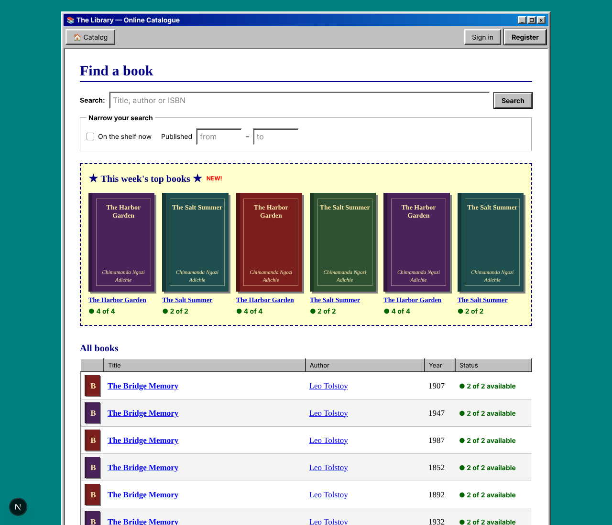
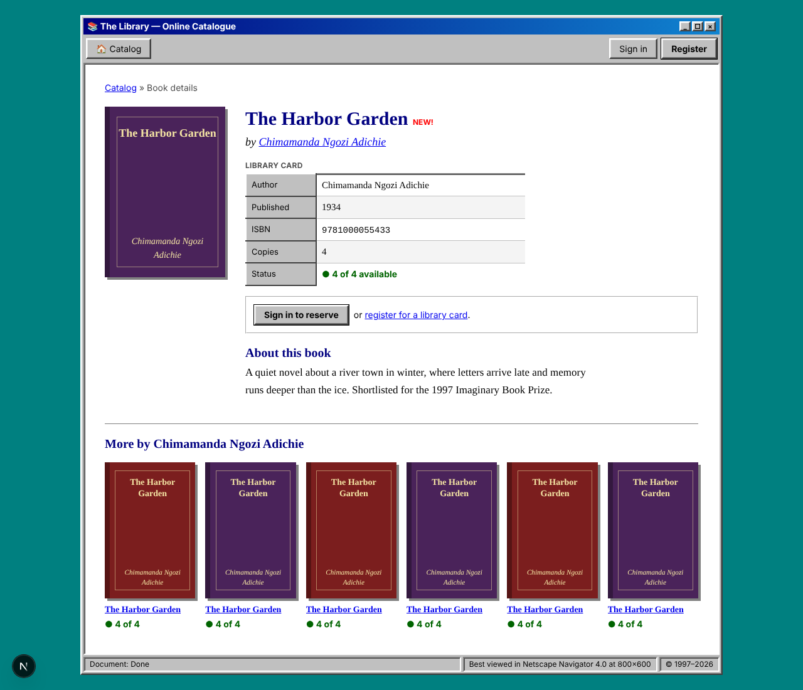
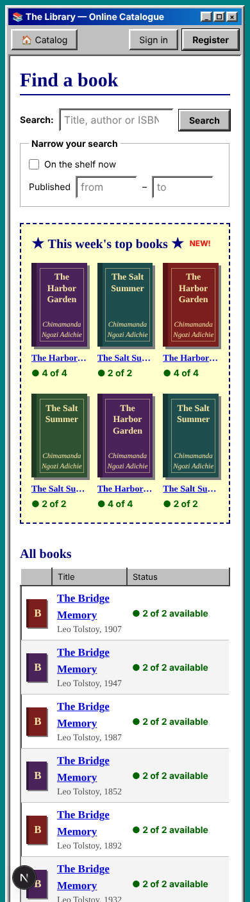
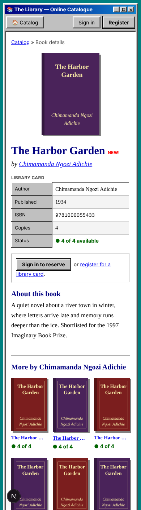

# The Library: documentation

A small public-library website: people search the catalogue and reserve books online, and staff run the desk from an admin area. Built on Next.js 16, Neon Postgres and Neon Auth, deployed on Vercel in Frankfurt. It deliberately looks like a 1997 Windows 95 web page.

## Guides

| Read this | If you want to |
|---|---|
| [User guide](user-guide.md) | Know what a visitor or member can do and how each screen works |
| [Admin guide](admin-guide.md) | Run the library: books, top picks, holds, loans, users, exports |
| [Architecture](architecture.md) | Understand how the code is laid out, how a request flows, and why it's fast |
| [Database](database.md) | See the schema, migrations, indexes and the rules the SQL enforces |
| [Design system](design-system.md) | Change the look: the retro theme, its CSS classes and components |
| [Development](development.md) | Set up locally, run tests, follow the code conventions |
| [Deployment](deployment.md) | Ship to Vercel and Neon, run migrations, roll back, debug production |
| [Changelog](changelog.md) | See what changed and what's still open |

## In one minute

- **Visitors:** search by title, author or ISBN. They can filter to books on the shelf now, filter by publication year, browse "This week's top books", and open a book page with a library card and more books by the same author.
- **Members:** reserve up to 10 books at once. A hold lasts 7 days until pickup. Members can return, cancel or delete their reservations.
- **Admins:** add, edit, delete and restore books, and flag top picks for 7 days. At the desk they mark pickups and returns, extend or cancel holds, and spot overdue loans (over 28 days). They can also manage admin roles and export CSVs.
- **Speed:** pages are partially prerendered. The static shell is served instantly and the data streams in. There are no web fonts or images, and every list query uses an index.

## Screenshots

| Book page (desktop) | Catalogue (phone) | Book page (phone) |
|---|---|---|
|  |  |  |

Search results and the 404 page: [search-desktop.png](screenshots/search-desktop.png), [404.png](screenshots/404.png).
