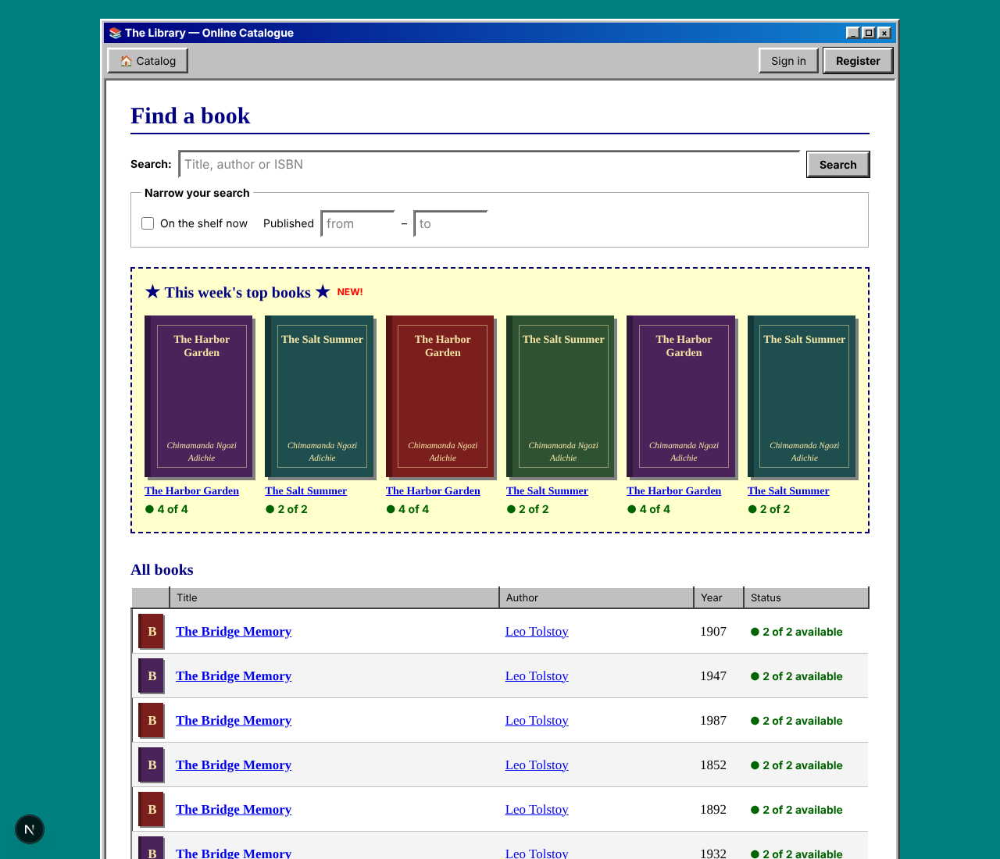

# Design system

The site is styled as a Windows 95 browser window from about 1997. The joke only works if it is still easy to use, so the retro look sits on top of normal usability rules: readable type, AA contrast, visible focus, phone layouts and fast loads.

## Principles

1. **Retro surface, modern behaviour.** It has bevels, Times New Roman and blue links, but responsive layouts, keyboard support and reduced-motion support underneath.
2. **Costs nothing to load.** System fonts only, no images or GIFs. Covers and bevels are CSS.
3. **One place to change it.** Tokens and component classes live in `src/app/globals.css`. Shared React pieces live in `src/components/ui.js`.

## Tokens (`@theme` in `globals.css`)

| Token | Value | Use |
|---|---|---|
| `desktop` | `#008080` | page background (the teal Win95 desktop) |
| `silver` | `#c0c0c0` | window chrome, buttons, table headers |
| `shadow` | `#808080` | bevel shadows, rules |
| `navy` | `#000080` | title bar, headings |
| `link` / `visited` | `#0000ee` / `#551a8b` | classic link colours; hover is red |
| `muted` | `#505050` | secondary text (AA on white) |
| `paper` | `#ffffcc` | notices, top-books shelf, row hover |
| `ok` / `bad` | `#006400` / `#a00000` | available / unavailable, success / error |
| `font-serif` | Times New Roman | body text |
| `font-ui` | Tahoma, Verdana | controls and labels (class `ui`) |

Tailwind generates utilities from these, for example `text-navy`, `bg-paper`, `text-muted` and `border-shadow`.

## Component classes

| Class | Looks like | Use for |
|---|---|---|
| `.btn` | grey raised button that presses in on click | every button and button-like link |
| `.btn-primary` | bold, with a black frame (Win95 "default button") | the main action on a screen |
| `.btn-danger` | red label | delete, cancel |
| `.btn-sm` | smaller | toolbars, table rows |
| `.field` | sunken white box | text, number and search inputs |
| `.bevel-out` / `.bevel-in` | raised / sunken border | panels, status-bar cells, tables |
| `.groupbox` | etched frame with a `<legend>` | grouped form controls |
| `.window`, `.titlebar`, `.titlebar-btn` | window chrome | the layout frame and dialogs |
| `.retro-table` | silver headers, zebra rows, yellow hover | lists of records |
| `.blink` | 1997 blinking | the NEW! badge only; turned off by `prefers-reduced-motion` |
| `.progress-blocks` | chunky progress bar | the loading dialog |
| `.ui` | Tahoma | short UI text inside serif content |

## React components

| Component | File | Notes |
|---|---|---|
| `PageTitle` | `ui.js` | navy serif h1 with an underline rule; optional `action` slot |
| `Skeleton` | `ui.js` | "Loading… please wait" dialog; `rows` reserves height to avoid layout shift |
| `Availability` | `ui.js` | `● 2 of 3 available` / `○ None available`; `short` drops the word "available" |
| `TopPickBadge` | `ui.js` | blinking red NEW! |
| `StatusBadge` | `ui.js` | sunken label for reservation status |
| `Pagination` | `ui.js` | « Previous · Page N · Next » |
| `BookCover` | `book-cover.js` | CSS cloth-bound cover; colour from the book id; sizes `sm` (spine), `md` (shelf), `lg` (book page) |
| `BookTable` | `book-table.js` | catalogue results; author/year fold under the title on phones |
| `CoverShelf` | `book-table.js` | grid of covers (3 per row on phones, 6 on desktop) |
| `SearchForm` | `search-form.js` | GET form via `next/form`; children slot for filters |
| `CatalogFilters` | `catalog-filters.js` | "Narrow your search" group box |
| `ActionButton` | `action-button.js` | one-button server-action form with ⚠ error / ✔ message |

## Layout

- The window is at most `max-w-5xl` (1024px), centred on the teal desktop. On phones the margin is 8px, and the window fills the width.
- The toolbar wraps on small screens.
- The status-bar footer reads "Document: Done", plus the obligatory "Best viewed in Netscape Navigator 4.0".

## Accessibility checklist for new UI

- Use real elements: `<button>`, `<a>`, `<label>`, `<table>` with `scope`, `<fieldset>`/`<legend>`.
- Decorative chrome (title-bar buttons, covers) gets `aria-hidden="true"`.
- Status and error messages use `role="status"` or `role="alert"`.
- Don't remove the dotted `:focus-visible` outline.
- Any new animation needs a `prefers-reduced-motion` fallback.
- Inputs stay at 16px.
- Check contrast with `muted` and `paper` before using a new colour.
